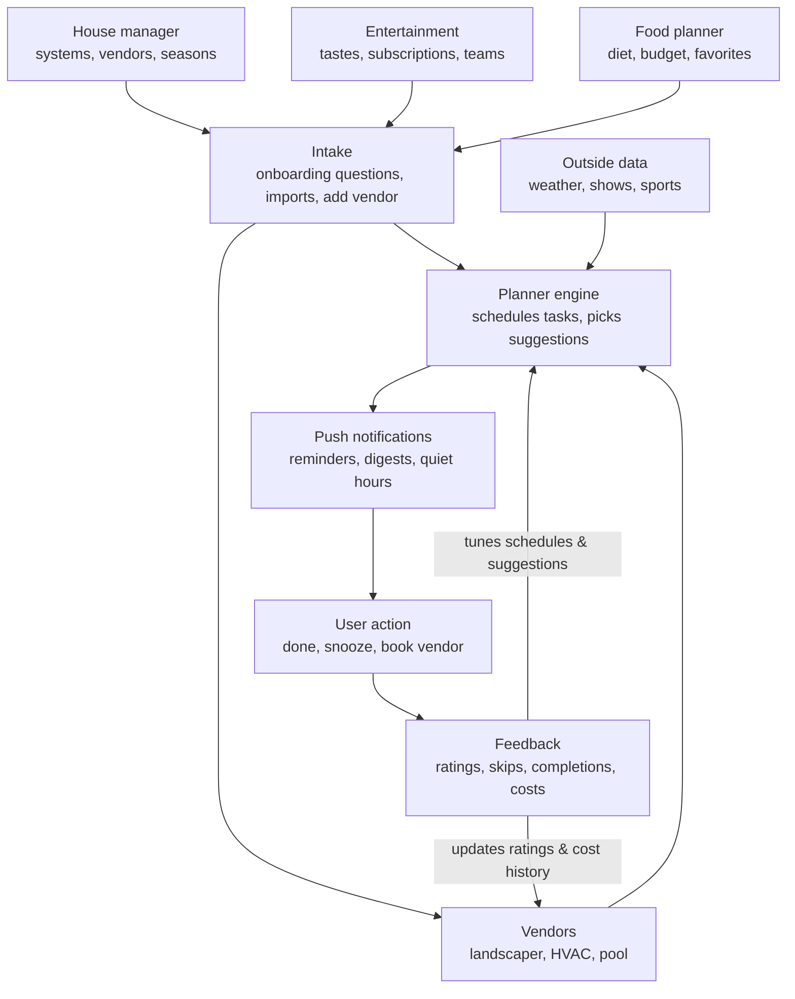

# Home / Life Manager Web App — Product & Technical Spec

Handoff spec for implementation. Build a web app (installable as a PWA) that helps a household manage home maintenance, entertainment choices, and food planning, with push notifications and a feedback loop that improves scheduling and suggestions over time.

---

## 1. Goals

- One place to track home systems, recurring maintenance, and the vendors who service them.
- Timely, low-noise push notifications for what needs doing (or watching, or eating).
- Learn from user behavior (completions, snoozes, skips, ratings, costs) to improve future schedules and suggestions.
- Visual first: the user wants to *see* seasonal work, schedules, and vendor history, not just read lists.

## 2. Modules

### 2.1 House manager
Covers home maintenance, landscaping, seasonal work, HVAC service, and pool service.

- **Home systems** (HVAC, pool, irrigation, roof, gutters, water heater, lawn, etc.): type, install date/age, model, notes, last service date, service interval.
- **Tasks**: recurring or one-off, linked to a system and optionally a vendor. Seasonal tasks driven by month and weather (e.g. "winterize irrigation before first frost").
- **Visual views (priority)**:
  - Seasonal maintenance calendar (month-by-month grid of tasks).
  - Per-system service timeline (past visits + upcoming due dates).
- Intake: an onboarding questionnaire about the house (user has a list of questions to supply; build the questionnaire to be data-driven so questions can be added/edited without code changes).

### 2.2 Vendors (part of house manager, first-class entity)
User can add vendors during intake or at any time.

Vendor record:
- Name, company, phone, email, website
- Services offered (mowing, leaf cleanup, HVAC tune-up, pool opening/closing…)
- Linked home systems
- Recurring schedule (e.g. every 2 weeks, April–October)
- Visit history: date, cost, notes, photos (optional), rating (1–5)
- Derived: average rating, average cost, last visit, next scheduled visit

Behaviors:
- Tasks can be assigned to a vendor.
- Notifications can offer one-tap contact ("Pool service due — text Mike's Pools?") via `tel:` / `sms:` / `mailto:` links.
- After a vendor-linked task is marked done, prompt for rating + cost (feeds the feedback loop).
- Planner prefers higher-rated vendors when suggesting who to book.

### 2.3 Entertainment
"What should we watch tonight?" plus new shows, books, and sports events.

- Intake: streaming services subscribed to, favorite genres, shows being followed, favorite authors, sports teams.
- Outputs: tonight's pick, new-season / new-release alerts for followed shows/authors, upcoming games for followed teams.
- Outside data candidates: TMDB (movies/TV), JustWatch-style availability data, Open Library / Google Books, a sports schedule API.

### 2.4 Food planner
Weekly groceries and going-out restaurants.

- Intake: dietary needs, household size, budget, staple items, favorite meals, favorite restaurants.
- Outputs: weekly meal plan, generated grocery list (editable, check-off-able), restaurant suggestions ("haven't tried somewhere new in a month").
- Weekly prompt (e.g. Sunday) to plan the week.

## 3. System flow



### Phases
1. **Intake** (mostly one-time, editable anytime): module questionnaires, vendor entry, preferences.
2. **Execution** (scheduled): planner engine runs on a schedule (e.g. hourly job + daily planning pass), produces dated tasks and suggestions, queues notifications.
3. **Feedback**: every user action is logged and used to adjust future behavior.

## 4. Planner engine

Runs as a scheduled background job.

- **Recurring tasks**: compute next due date from interval + last completion (not last scheduled date, so snoozes shift the cadence).
- **Seasonal/weather tasks**: pull forecast for the home's location; trigger tasks on conditions (first frost forecast → winterize irrigation; heat wave → check HVAC filter).
- **Suggestions**: entertainment and food picks scored against preferences, minus recently skipped/disliked items.
- **Vendor selection**: when a task needs a vendor, prefer linked vendor; otherwise rank by rating, then cost.
- Keep rules simple and explicit for v1 (rule-based scoring). An LLM-based suggestion step can be added later behind an interface.

## 5. Push notifications

- Use **Web Push** via a service worker (VAPID keys). Options: native Web Push (`web-push` npm package), Firebase Cloud Messaging, or OneSignal.
- **iOS**: Web Push only works when the app is installed to the Home Screen as a PWA (iOS 16.4+). Include a manifest, service worker, and an in-app "Add to Home Screen" prompt with instructions.
- Notification types:
  - Time-sensitive alerts (vendor visit tomorrow, frost warning task, game starts in 1 hour).
  - Weekly digest (upcoming week's house tasks, meal-plan prompt, new releases).
  - Friday/evening "what to watch" pick (opt-in).
- **Actions on notifications**: Done, Snooze (1 day / 1 week), Contact vendor, Open.
- User settings: per-module on/off, quiet hours, digest day/time, max notifications per day.
- Log every send and every action (feeds feedback).

## 6. Feedback loop

Signals captured:
- Task completed (on time / late), snoozed (how long), skipped/dismissed.
- Suggestion accepted, skipped, or rated (thumbs up/down).
- Vendor visit rating + actual cost.
- Notification opened vs ignored.

How signals are used:
- **Planner**: shift recurring task timing toward actual completion patterns; down-weight suggestion categories that get skipped; reduce frequency of notification types that are consistently ignored.
- **Vendors**: update average rating, cost history, reliability (visits completed as scheduled).

## 7. Data model (starting point)

```
User(id, name, email, timezone, location_lat, location_lng, notification_settings)
Household(id, name, address, lat, lng)  -- user belongs to household (allow multiple members later)

HomeSystem(id, household_id, type, name, install_date, model, notes, service_interval_days)
Vendor(id, household_id, name, company, phone, email, website, services[], notes)
VendorSystem(vendor_id, home_system_id)
VendorSchedule(id, vendor_id, rrule, season_start_month, season_end_month)
Task(id, household_id, module, title, home_system_id?, vendor_id?, recurrence_rrule?, due_at, status, source[manual|recurring|seasonal|weather])
VendorVisit(id, vendor_id, task_id?, date, cost, rating, notes)

Preference(id, user_id, module, key, value)          -- genres, teams, diet, budget, etc.
Suggestion(id, user_id, module, item_type, external_id, title, score, created_at, status)
MealPlan(id, household_id, week_start)
MealPlanItem(id, meal_plan_id, day, meal, recipe_ref)
GroceryItem(id, household_id, meal_plan_id?, name, qty, checked)
Restaurant(id, household_id, name, cuisine, last_visited, rating)

PushSubscription(id, user_id, endpoint, keys_json, user_agent, created_at)
Notification(id, user_id, type, payload_json, scheduled_for, sent_at, opened_at, action)
FeedbackEvent(id, user_id, entity_type, entity_id, event, value, created_at)

IntakeQuestion(id, module, key, prompt, input_type, options_json, order)  -- data-driven questionnaire
IntakeAnswer(id, household_id, question_id, value)
```

## 8. Suggested stack (adjust as preferred)

- **Frontend**: Next.js (App Router) + TypeScript + Tailwind, built as a PWA (manifest + service worker).
- **Backend**: Next.js route handlers / server actions.
- **DB**: Postgres (Supabase or Neon) with Prisma or Drizzle.
- **Auth**: Supabase Auth, Clerk, or NextAuth.
- **Jobs / scheduling**: Vercel Cron, Supabase scheduled functions, or Inngest/Trigger.dev for the planner engine and notification queue.
- **Push**: `web-push` with VAPID keys (or FCM/OneSignal).
- **Calendar views**: FullCalendar or a custom month grid; timeline with a simple custom component.
- **Outside data**: weather (Open-Meteo, no key required), TMDB, Open Library, a sports schedule API; Google Calendar API optional for syncing vendor visits.

## 9. MVP scope (build order)

1. Auth, household, PWA shell (manifest, service worker, install prompt).
2. House manager: home systems, tasks with recurrence, seasonal calendar view, per-system timeline.
3. Vendors: CRUD, link to systems/tasks, visit log with rating + cost, contact links.
4. Planner job: compute due tasks daily; weather-triggered seasonal tasks.
5. Push notifications: subscribe, send reminders + weekly digest, notification actions (done/snooze), settings with quiet hours.
6. Feedback logging + basic adjustments (snooze-shifted cadence, vendor rating aggregates).
7. Food planner: preferences, weekly plan, grocery list.
8. Entertainment: preferences, TMDB-based picks, followed shows/teams alerts.

## 10. Open questions

- Single user or multiple household members (shared tasks, per-person notifications)?
- Should the app message vendors directly (SMS/email from the app) or only open the user's phone/email client?
- House questionnaire content — user will supply the question list.
- Preferred stack/hosting, if different from the suggestion above.
- Sync tasks/vendor visits to Google Calendar?
